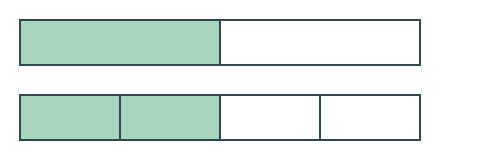

# Gleiche Anteile erkennen

## Gesprächsimpuls

Was ist gleich geblieben, obwohl mehr Teilstücke zu sehen sind?

> [!definition] Erweitern
> Das Multiplizieren von Zähler und Nenner eines Bruchs mit derselben natürlichen
> Zahl $k \neq 0$ heißt **Erweitern**.

## Beispiel

$$
\frac{1}{2}=\frac{2}{4}
$$

> [!merksatz] Wert eines Bruchs
> Beim Erweitern bleibt der Wert des Bruchs gleich. Für $b \neq 0$ und $k \neq 0$ gilt:
>
> $$\frac{a}{b}=\frac{a\cdot k}{b\cdot k}$$
